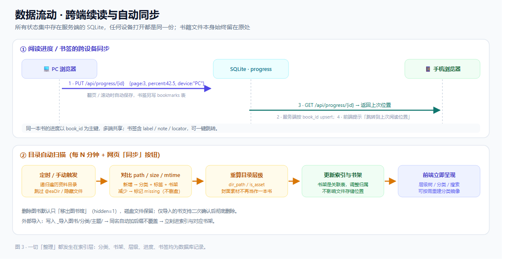
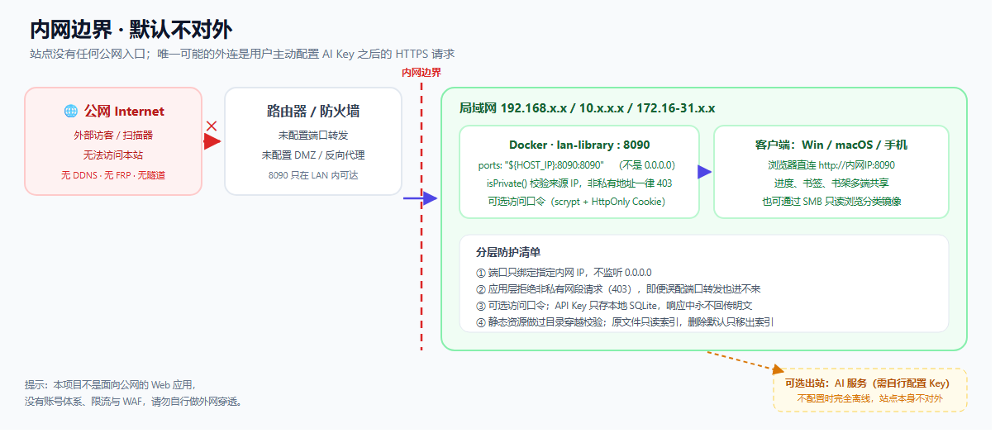
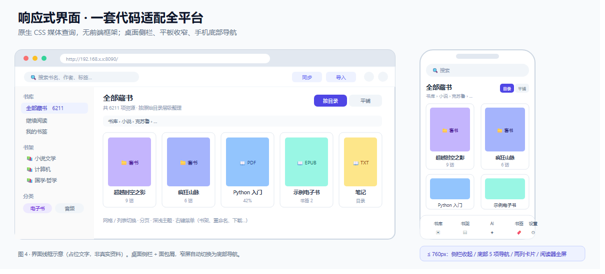
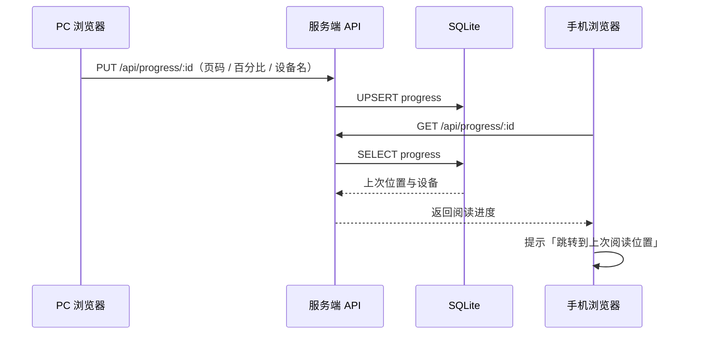

# LAN Library · 局域网数字图书馆

[](LICENSE)
[](https://nodejs.org/)
[](docker-compose.yml)
[](CONTRIBUTING.md)
[](#-安全与隐私)

> 把一整个资料文件夹变成「图书馆」——**不搬动、不复制、不删除任何一个原文件**。
> 自动按目录层级整理、智能分类、生成真实封面，支持多格式在线阅读、跨设备续读、书架、书签和 AI 阅读助手；**只在局域网内提供服务**。

一个 Docker 容器、一份 SQLite 索引、零 npm 运行时依赖（PDF.js / JSZip 已内置），可在 Windows / macOS / 手机浏览器、群晖 NAS、任意 Linux 主机上运行。已在 6000+ 文件 / 800 GB 量级的真实资料库上验证。

<details>
<summary><b>English summary</b></summary>

LAN Library turns an existing folder of study materials into a private, LAN-only digital library. It indexes files in place (never moves or deletes them), builds a browsable folder hierarchy with automatic series detection, generates real covers, and serves a responsive reader for PDF / EPUB / TXT / MOBI / DOCX and more. Reading progress, bookmarks, shelves and AI settings are stored in a single SQLite database so every device sees the same state. No public exposure, no external tunnel, no account system. AI question-answering is optional and requires your own API key.

</details>

---

## 目录

- [特性](#-特性)
- [示意图](#-示意图)
- [快速开始](#-快速开始)
- [配置说明](#-配置说明)
- [项目结构](#-项目结构)
- [功能详解](#-功能详解)
- [API 速查](#-api-速查)
- [安全与隐私](#-安全与隐私)
- [开发与测试](#-开发与测试)
- [常见问题](#-常见问题)
- [贡献](#-贡献)
- [许可证与第三方组件](#-许可证与第三方组件)

---

## ✨ 特性

| 能力 | 说明 |
| --- | --- |
| **零搬移整理** | 原文件一个字节都不动；分类、标签、层级、书架全部是 SQLite 索引记录。文件减少只标记失效，不删磁盘文件 |
| **目录层级浏览** | 按磁盘真实目录链逐层进入，带面包屑；空目录链自动展开；不同目录下的同名「第01回」绝不混在一起 |
| **套书自动聚合** | `第0X回 / 第0X话 / 01卷 / 01` 等序号型目录合并为一张套书卡片，点进去按自然序排列章节 |
| **真实封面** | 现成封面图 → 图片原图 → EPUB 内嵌封面 → PDF 首页（浏览器渲染后回传缓存）→ 排版式文字封面兜底；一次生成，全设备共用 |
| **多格式阅读** | PDF、EPUB、TXT/MD/CSV、MOBI/AZW、DOCX/PPTX、MHT/HTML 网页内阅读；图片/常见音视频可播放，其余格式可下载 |
| **跨端续读** | 阅读进度按书存服务端，PC / Mac / 手机共享；打开时提示跳转到上次位置，并记录来源设备 |
| **书签** | 支持标签、备注、定位跳转、改名与删除 |
| **书架** | 默认按顶层文件夹生成；书架与图书均可增删改查，调整归属不影响文件存储位置 |
| **自动扫描同步** | 每 N 分钟增量扫描 + 网页手动「同步」；按 `path / size / mtime` 判断新增与减少 |
| **外部导入** | 浏览器拖入文件 → 按智能分类落到 `_导入图书/分类/主题/` → 同名不覆盖 → 立即进索引与书架 |
| **分类镜像** | 可选生成 `_图书馆分类/分类/原目录链/文件名`，用**硬链接**实现零额外空间的「整理后目录」，SMB 也能看 |
| **AI 阅读助手** | 阅读时侧栏提问，可带选中文字作上下文，SSE 流式回答；支持 DeepSeek / 豆包 / 任意 OpenAI 兼容端点 |
| **仅内网** | 端口只绑定指定局域网 IP；应用层拒绝非私有 IP（403）；可选访问口令；无外网映射、无穿透、无遥测 |
| **全平台适配** | 响应式布局：桌面侧栏、平板收窄、手机底部导航；深浅主题；无前端框架、无 CDN 依赖 |

---

## 🧭 示意图

> 每张图都有两份：`docs/images/*.png` 用于 README 预览（兼容所有 Markdown 渲染器），`docs/images/*.svg` 是可编辑的矢量源。改图时编辑 SVG 后重新导出 PNG 即可。

### 1. 系统架构


客户端只需浏览器；容器内部由 HTTP 服务、扫描/分类引擎、SQLite 与封面服务组成；资料目录以 bind mount 挂入，原件只读索引。右侧的 AI 服务是**唯一可选外连**，不配置时整套系统完全离线。

### 2. 目录层级与套书聚合


截图里「第03回」被平铺摊开的问题，根因是旧版按分类平铺 6000+ 文件。现在按磁盘目录链建树：同一套漫画的 9 个分回收进一张「套书」卡片，另一套的 2 卷各自独立，互不混淆。分类镜像也保留同样的层级。

### 3. 数据流动



阅读进度、书签、书架都是服务端数据库记录；扫描只对比元数据，不读取文件内容，几千个文件的增量扫描通常在 1 秒内完成。

### 4. 内网安全边界



### 5. 响应式界面



### 部署流程（Mermaid）


### 跨端续读时序（Mermaid）



---

## 🚀 快速开始

### 前置条件

- Docker + Docker Compose v2（或群晖 Container Manager / 其他支持 Compose 的容器平台）
- 一份已有的资料目录，例如 `学习资料/`，里面可以有任意层级、任意数量的文件
- 一台与客户端处于同一局域网的主机

> 不需要数据库服务、不需要 npm install、不需要外网（AI 功能除外）。

### 方式 A：Docker Compose（推荐，通用）

```bash
git clone https://github.com/<your-name>/lan-library.git
cd lan-library

cp .env.example .env         # 然后按下面「配置说明」修改
mkdir -p data library-data

# 把你的资料放到 PUBLIC_HOST/LIBRARY_SUBDIR 对应的位置。
# 以模板默认值为例，即 ./library-data/学习资料/，也可以直接用软链接指向已有目录：
#   ln -s /path/to/学习资料 ./library-data/学习资料

docker compose up -d --build
docker compose logs -f        # 首次启动会打印扫描结果
curl http://<HOST_IP>:8090/api/health     # 返回 {"ok":true,...} 即成功
```

同一局域网的设备打开 `http://<HOST_IP>:8090`。若填的是 `127.0.0.1`，只有主机本机可访问。

### 方式 B：群晖 Synology / Container Manager

1. 在 DSM 中安装 **Container Manager**，开启 SSH。
2. 把仓库放到共享目录，例如 `/volume1/docker/lan-library`，并创建 `data/`。
3. 参考 `.env.example` 创建 `.env`，示例：

   ```ini
   HOST_IP=192.168.1.10
   PORT=8090
   PUBLIC_HOST=/volume1/your-share
   LIBRARY_SUBDIR=学习资料
   DATA_HOST=/volume1/docker/lan-library/data
   SCAN_INTERVAL_MIN=10
   ```

4. 在 Container Manager 中「项目 → 新增 → 从 docker-compose.yml 创建」，或在 SSH 中执行 `docker compose up -d --build`。

也可以用仓库自带的辅助脚本从本机一键上传并启动（脚本走 SSH 的 tar 通道，兼容未开放 SFTP 的群晖；凭据只从环境变量读取）：

```bash
pip install paramiko
NAS_HOST=192.168.1.10 NAS_USER=your_user NAS_PWD=your_password \
  python deploy/deploy.py
```

更多细节见 [docs/DEPLOYMENT.md](docs/DEPLOYMENT.md)。

### 方式 C：本地开发（不装 Docker）

需要 Node.js 22+（使用内置 `node:sqlite`）：

```bash
PORT=8090 \
DATA_DIR=./data \
BOOKS_ROOT=./library-data/学习资料 \
PUBLIC_ROOT=./library-data \
node --experimental-sqlite server/index.js
```

浏览器打开 `http://127.0.0.1:8090`。改前端代码后刷新即可；改后端需重启进程。

### 首次使用建议

1. 打开网页 → 点右上角「同步」，确认索引数量与磁盘文件数一致。
2. 在「设置」里可开启访问口令、填写 AI Key（不填也能正常使用）。
3. 想让 SMB / 文件管理器里也看到整理后的目录，调用一次 `POST /api/organize/materialize` 生成分类镜像。

---

## ⚙️ 配置说明

所有本机相关的配置都写在 `.env`（**已被 `.gitignore` 忽略，不会被提交**），模板见 `.env.example`。

| 变量 | 默认值 | 说明 |
| --- | --- | --- |
| `HOST_IP` | `127.0.0.1` | 端口绑定的局域网 IP。**必须填本机内网 IP** 才能让手机/其他电脑访问；不要填 `0.0.0.0` |
| `PORT` | `8090` | 对外端口，完整地址 `http://HOST_IP:PORT` |
| `PUBLIC_HOST` | 必填（模板为 `./library-data`） | 资料目录的**父目录**，容器内挂到 `/lanpublic`。分类镜像也生成在这里 |
| `LIBRARY_SUBDIR` | `学习资料` | 资料目录名；书库根目录 = `${PUBLIC_HOST}/${LIBRARY_SUBDIR}` |
| `DATA_HOST` | `./data` | SQLite 数据库、封面缓存、设置的持久化位置 |
| `SCAN_INTERVAL_MIN` | `10` | 自动扫描间隔（分钟），最小 1 |
| `TZ` | `Asia/Shanghai` | 容器时区 |

应用内部环境变量（一般由 Compose 注入，无需手改）：

| 变量 | 容器内默认 | 说明 |
| --- | --- | --- |
| `PORT` | `8090` | HTTP 监听端口 |
| `DATA_DIR` | `/data` | 数据库与封面缓存目录 |
| `BOOKS_ROOT` | `/lanpublic/books` | 资料根目录（Compose 会设为 `/lanpublic/${LIBRARY_SUBDIR}`） |
| `PUBLIC_ROOT` | `/lanpublic` | 资料父目录；分类镜像写到 `${PUBLIC_ROOT}/_图书馆分类` |
| `SCAN_INTERVAL_MIN` | `10` | 自动扫描间隔 |
| `IMPORT_DIR` | `_导入图书` | 外部导入的落盘目录名 |
| `MIRROR_DIR` | `_图书馆分类` | 分类镜像目录名 |

> ⚠️ **硬链接前提**：`PUBLIC_HOST` 必须是**单个挂载点**，资料目录与 `_图书馆分类` 必须在同一文件系统内。若资料与镜像分别来自不同卷/挂载点，硬链接会报 `EXDEV`，此时索引与网页功能不受影响，只是分类镜像无法生成。

---

## 🗂 项目结构

```text
lan-library/
├── docker-compose.yml          # 仅绑定内网 IP；配置全部来自 .env
├── Dockerfile                  # node:22-bookworm-slim，零 npm install
├── .env.example                # 配置模板（复制为 .env 使用）
├── .env                        # 本地配置，被 .gitignore 忽略
├── server/
│   ├── index.js                # HTTP 服务、路由、内网校验、AI 代理、导入、静态资源
│   ├── core.js                 # SQLite 表结构、智能分类、增量扫描、书架、分类镜像
│   ├── tree.js                 # 目录前缀树、套书判定、章节自然序、自动展开
│   └── covers.js               # 封面解析 / 缓存 / SVG 兜底
├── public/
│   ├── index.html              # 单页骨架
│   ├── style.css               # 全部样式与响应式断点
│   ├── app.js                  # 前端逻辑、阅读器、书架、书签、AI 侧栏、封面队列
│   └── vendor/                 # 内置 PDF.js、JSZip、CMap 字体数据（离线可用）
├── deploy/
│   └── deploy.py               # 可选：SSH 上传到 NAS 并 compose up
├── docs/
│   ├── images/                 # 本 README 使用的 SVG 示意图
│   ├── API.md                  # 完整接口说明
│   └── DEPLOYMENT.md           # 部署、备份、升级与排障
├── .github/                    # CI、Issue / PR 模板
├── LICENSE                     # MIT
├── CONTRIBUTING.md
├── SECURITY.md
├── CHANGELOG.md
└── THIRD_PARTY_NOTICES.md
```

`data/`（运行时生成）包含 `library.db` 与 `covers/`；`library-data/`（示例资料目录）与二者都不入库。

---

## 📖 功能详解

### 1. 智能分类整理（原文件零搬移）

扫描时递归遍历资料目录（最多 12 层），跳过 `@eaDir`、`Thumbs.db`、临时文件等噪音，对每个文件计算：一级分类、二级主题、标签、类型、格式、目录路径、是否为封面素材。

- 一级分类优先取顶层文件夹映射（`计算机 / 语言 / 数学 / 历史 / 小说 / 道`），否则按文件名与路径关键词推断（如「人工智能」「考研」「金融」）。
- 二级主题按 `SUB_TOPICS` 关键词细分（Python、Java、前端、算法、英语、经史典籍…）。
- 规则全部在 [`server/core.js`](server/core.js) 的 `TOP_CATEGORY / KEYWORD_CATEGORY / SUB_TOPICS` 里，可直接改成自己的分类体系。
- 分类结果只写数据库；**磁盘上的文件不会被移动、重命名、复制或删除**。

### 2. 按层级浏览与套书

- 默认「按目录」模式：面包屑 + 文件夹卡片 + 本层直属图书，路径写进 URL `?path=`，刷新/换设备可回到同一层。
- 右上角可切「平铺」；搜索、继续阅读、书签视图自动使用平铺。
- 目录内文件多数为序号命名时，自动判定为「套书」，章节按自然数排序（第 2 话排在第 10 话前面）；有独立名字的短篇保留为普通文件夹。
- 仅有单一子目录且本层没有直属图书时自动展开，避免连点多层空白目录；面包屑仍保留完整路径。

### 3. 支持的格式

| 类别 | 格式 | 网页内 |
| --- | --- | --- |
| 电子书 | PDF、EPUB、MOBI / AZW / AZW3、FB2、DJVU、CHM | PDF（PDF.js）、EPUB / MOBI（JSZip / 文本提取）可阅读；部分小众格式提供下载 |
| 纯文本 | TXT、MD、CSV、MHT、HTML / HTM | 可阅读，自动处理 UTF-8 / GB18030 中文编码 |
| 文档 | DOCX、PPTX、DOC / PPT / XLS、RTF | DOCX / PPTX 可解析阅读；旧格式提供下载 |
| 图片 | JPG / PNG / WEBP / GIF / BMP / TIFF | 可预览，带「封面 / cover」字样的图片被识别为封面素材，不再当作一本书 |
| 音视频 | MP3 / WAV / FLAC / M4A / OGG、MP4 / WEBM / MOV / M4V | 可播放 |
| 其他 | RMVB / RM / FLV / WMV / VOB / MKV、ZIP / RAR / 7Z / ISO | 浏览器无法原生播放，提供下载 |

> 浏览器不支持 RMVB / FLV 等旧格式，这与浏览器能力有关，与本项目无关。

### 4. 封面

优先级：同目录现成封面图 → 图片本身 → EPUB 内嵌封面 → PDF 首页 → SVG 文字封面兜底。PDF 首页由浏览器用内置 PDF.js 渲染成 JPEG，通过 `POST /api/cover/:id` 回传并缓存在 `data/covers/`，**一次生成、所有设备共用**；已生成的不会重复渲染，超大扫描件（> 260 MB）自动跳过。所以首次浏览某批书时封面会陆续出现，之后固定。

### 5. 阅读进度与书签

进度记录 `locator`（页码 / 章节 / 滚动位置）、百分比、设备名与更新时间，按 `book_id` 为主键；书签含标签、备注和定位。两者都存在服务端 SQLite，跨设备即时可见。

### 6. 书架与图书增删改查

- 首次扫描按顶层文件夹自动创建默认书架，之后把每本书归入对应书架；导入书与根目录散文件按分类归入同名书架。
- 书架：新建、改名、改色/图标、删除、添加/移除图书。
- 图书：编辑标题/作者/分类/标签、移出图书馆（`hidden=1`，保留磁盘文件）、恢复。
- **只有从网页导入的书**支持二次确认 `?purge=1` 彻底删除；原始资料永远不会被删除。

### 7. 自动扫描与导入

- 定时（默认 10 分钟）+ 手动「同步」；对比 `size / mtime` 判断更新，新增入库并分类，消失的标记 `missing` 而不删记录。
- 导入：写入 `_导入图书/分类/主题/文件名`，同名自动加后缀不覆盖；随后立刻进索引与书架。

### 8. 分类镜像（可选）

`POST /api/organize/materialize` 在 `PUBLIC_HOST/_图书馆分类/` 下按「分类 / 原目录链 / 文件名」生成**硬链接**。它占用零额外空间，SMB / 文件管理器里也能看到整理后的目录；重建时通过 inode 校验，只清理本系统生成的旧链接，绝不碰原件。

> 硬链接与原件指向同一 inode：**删除链接不影响原件，但直接编辑链接文件会改到原件**，建议只读浏览。

### 9. AI 阅读助手

在「设置」中填写服务商、Base URL、模型名与 API Key，支持 DeepSeek、豆包（火山方舟 OpenAI 兼容端点）及任何 OpenAI 兼容服务。阅读时可对全书提问，或选中一段文字作为上下文，回答以 SSE 流式返回并保存会话历史。

- API Key 只存本地 `library.db`，接口返回时脱敏（只回显后 4 位）。
- 未配置 Key 时侧栏会提示去设置，其余功能完全可用、**不发生任何外连**。
- 启用后需要 NAS/主机能访问对应服务商的公网地址。

---

## 🔌 API 速查

完整说明见 [docs/API.md](docs/API.md)。所有接口均受内网校验与可选访问口令保护。

| 方法 | 路径 | 用途 |
| --- | --- | --- |
| GET | `/api/health` | 健康检查（无需口令） |
| GET | `/api/state` | 总数、书架数、封面数、上次扫描、AI 状态 |
| GET | `/api/tree` | 目录层级视图（`path` / `drill` / 分类 / 搜索等筛选） |
| GET | `/api/books` | 平铺列表、筛选、分页、排序 |
| GET | `/api/facets` | 分类 / 类型 / 格式 / 主题聚合 |
| GET | `/api/cover/:id` | 封面图（缺失时返回 SVG 兜底） |
| POST | `/api/cover/:id` | 回传浏览器渲染的 PDF 首页封面 |
| GET | `/api/raw/:id` | 原文件（支持 Range，供阅读器/播放器使用） |
| GET | `/api/text/:id` | 纯文本提取（UTF-8 / GB18030 / MOBI） |
| GET | `/api/download/:id` | 附件下载 |
| GET/POST/PATCH/DELETE | `/api/shelves...` | 书架与书架成员增删改查 |
| GET/PATCH/DELETE | `/api/books/:id` | 图书详情、编辑、移出 / 恢复 / 彻底删除 |
| GET/PUT | `/api/progress/:id` | 阅读进度读写 |
| GET/POST/PATCH/DELETE | `/api/bookmarks...` | 书签增删改查 |
| POST | `/api/scan` | 手动增量扫描 |
| POST | `/api/import` | 外部导入（请求头 `x-file-name` 为 URL 编码文件名） |
| POST | `/api/organize/materialize` | 生成 / 重建分类镜像硬链接 |
| GET/PUT | `/api/settings/ai` | AI 配置（Key 脱敏） |
| POST | `/api/ai/test` `/api/ai/chat` | 连通性测试 / 流式问答 |
| GET/DELETE | `/api/ai/history` | 会话历史 |
| POST | `/api/login`、PUT `/api/settings/pin` | 访问口令 |

---

## 🔒 安全与隐私

- **没有公网入口**：`docker-compose.yml` 只把端口绑定到 `HOST_IP`，不监听 `0.0.0.0`；仓库不含 DDNS、FRP、反向代理或任何隧道配置。
- **应用层二次校验**：服务端 `isPrivate()` 检查来源 IP，非私有网段（10/8、172.16/12、192.168/16、169.254、本地回环、私有 IPv6 之外）一律返回 `403`。
- **可选访问口令**：scrypt 加盐哈希 + HttpOnly Cookie；未设置时免登录（适合家庭内网）。
- **数据不外传**：没有账号体系、没有遥测、没有 CDN；静态资源与第三方库全部内置。唯一可能的外连是用户主动填写 Key 后的 AI 请求。
- **原文件保护**：资料目录只做索引；「删除图书」默认仅移出索引，只有导入书可二次确认后删除；静态资源与文件接口都做了路径穿越校验。
- **备份**：只需备份 `DATA_HOST`（`library.db` + `covers/`）；资料目录本身不受本项目影响。

> ⚠️ 本项目**不是面向公网的 Web 应用**：没有限流、WAF、CSRF 防护和账号体系。请不要把它做外网穿透或暴露到公网，也不要在不可信网络中关闭访问口令。详见 [SECURITY.md](SECURITY.md)。

---

## 🧪 开发与测试

```bash
# 语法检查（无需安装依赖）
for f in server/*.js public/app.js; do node --check "$f"; done

# 本地起一个最小实例
mkdir -p /tmp/ll-test/books/小说 /tmp/ll-test/data /tmp/ll-test/public
echo "第一章" > "/tmp/ll-test/books/小说/样例.txt"
PORT=18090 DATA_DIR=/tmp/ll-test/data \
BOOKS_ROOT=/tmp/ll-test/books PUBLIC_ROOT=/tmp/ll-test/public \
node --experimental-sqlite server/index.js

curl http://127.0.0.1:18090/api/state
curl http://127.0.0.1:18090/api/tree
```

CI（`.github/workflows/ci.yml`）会在推送/PR 时执行 JS 语法检查、敏感信息扫描、SVG/XML 校验和 Docker 镜像构建。前端为原生 JS，无构建步骤，改完刷新浏览器即可。

---

## ❓ 常见问题

**Q：手机 / 别的电脑打不开？**
确认 `.env` 里 `HOST_IP` 填的是主机的局域网 IP（不是 `127.0.0.1`），客户端与主机在同一网段，且主机防火墙放行 `PORT`。用 `docker compose ps` 看端口映射。

**Q：为什么有些封面一开始是文字占位？**
PDF 首页封面由浏览器首次打开时渲染并回传缓存，稍等片刻或刷新即可；超过 260 MB 的扫描件会跳过自动渲染。现成封面图 / EPUB 内嵌封面立即显示。

**Q：分类镜像生成失败 / 报 EXDEV？**
资料目录与镜像目录必须位于同一挂载点。把 `PUBLIC_HOST` 设为资料目录的父目录（单一 bind mount），不要分别挂载 `/data`、`/books`、`/lanpublic`。

**Q：删除一本书会删掉磁盘文件吗？**
默认不会，只标记 `hidden` 移出图书馆；仅网页导入的书支持 `?purge=1` + 二次确认后彻底删除。分类镜像里的链接删掉也不影响原件。

**Q：分类不合我意怎么改？**
编辑 `server/core.js` 里的 `TOP_CATEGORY`、`KEYWORD_CATEGORY`、`SUB_TOPICS`，重启容器后点「同步」；已有记录会在扫描时按新规则更新。

**Q：RMVB / FLV / WMV 为什么不能播放？**
浏览器不支持这些编码，只能下载后用本地播放器打开。PDF / EPUB 等电子书不受影响。

**Q：AI 一定要联网吗？**
不配置 AI Key 时全站完全离线。配置后，问答请求由服务端转发到你填的 Base URL，需要 NAS 能访问公网；网站本身依旧只监听内网。

**Q：如何备份 / 升级？**
备份 `DATA_HOST` 整个目录即可。`git pull` 后 `docker compose up -d --build`，数据库会自动做字段迁移，进度、书签、书架和设置都会保留。不要轻易使用 `RESET_DB=1`，它会删除数据库重建索引。

---

## 🤝 贡献

欢迎 Issue、功能建议与 Pull Request。请先阅读 [CONTRIBUTING.md](CONTRIBUTING.md)（开发约定、提交格式、测试要求），漏洞报告请按 [SECURITY.md](SECURITY.md) 的方式私下反馈。

一些适合入门的方向：更多电子书格式（CBZ / AZW3 排版）、OPDS 支持、多用户与只读角色、封面提取的更多来源、分类规则配置化、国际化文案。

---

## 📦 发布到自己的 GitHub

仓库里凡是出现 `<your-name>` 的地方都是**占位符**（README / CONTRIBUTING / CHANGELOG / `.github/ISSUE_TEMPLATE/config.yml` 等），首次发布前替换成你的 GitHub 用户名即可：

```bash
# Linux / macOS
grep -rl '<your-name>' . --exclude-dir=.git | xargs sed -i 's/<your-name>/YOUR_GITHUB_NAME/g'

# Windows PowerShell
Get-ChildItem -Recurse -File | Where-Object { $_.FullName -notmatch '\\\.git\\' } |
  ForEach-Object { (Get-Content $_.FullName -Raw) -replace '<your-name>','YOUR_GITHUB_NAME' |
                   Set-Content $_.FullName -NoNewline }
```

然后：

```bash
git init -b main
git status --short            # 确认没有 .env / data / *.db / 截图
git add .
git commit -m "chore: initial open-source release (v0.2.0)"
git remote add origin https://github.com/YOUR_GITHUB_NAME/lan-library.git
git push -u origin main
```

建议再在仓库设置里开启 **Private vulnerability reporting**（与 [SECURITY.md](SECURITY.md) 对应），并按 [CHANGELOG](CHANGELOG.md) 打一个 `v0.2.0` tag。CI 会自动跑语法检查、私有配置检查、SVG 校验和镜像构建。

---

## 📜 许可证与第三方组件

本项目采用 **MIT License**，详见 [LICENSE](LICENSE)。你可以自由使用、修改、商用与再分发，只需保留版权声明与许可证文本。

内置的第三方库及其许可证见 [THIRD_PARTY_NOTICES.md](THIRD_PARTY_NOTICES.md)：PDF.js（Apache-2.0）、JSZip（MIT / GPLv3 双许可）、Node.js（MIT）与 `node:sqlite`。

---

<p align="center">为那些不愿把资料交给云端的书架而做。 📚</p>
