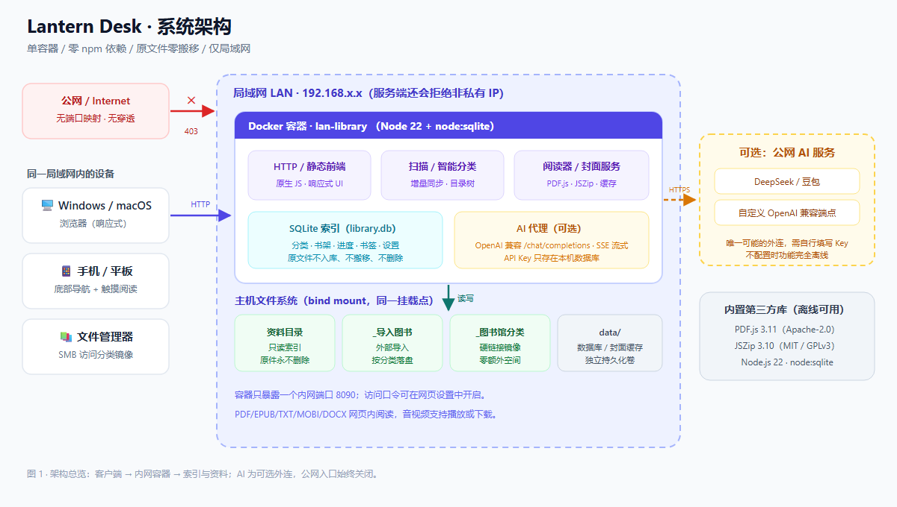
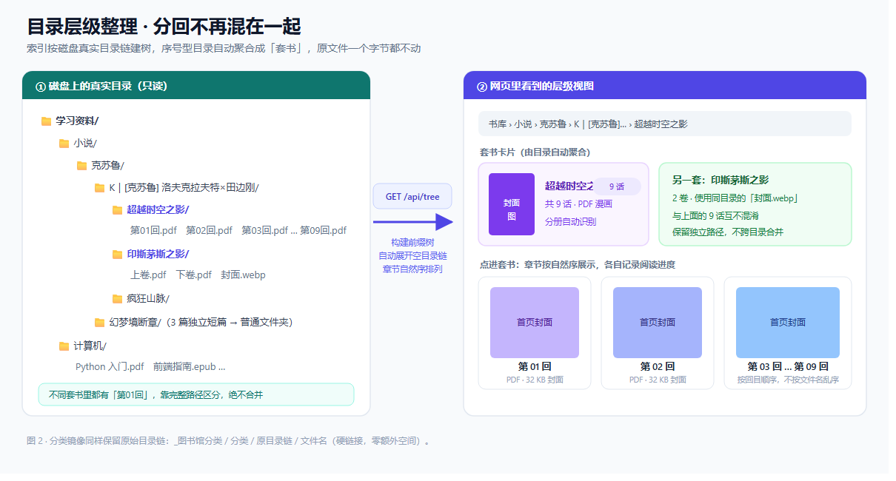
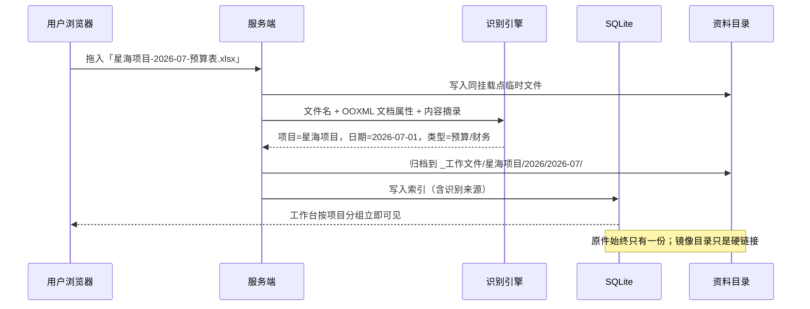
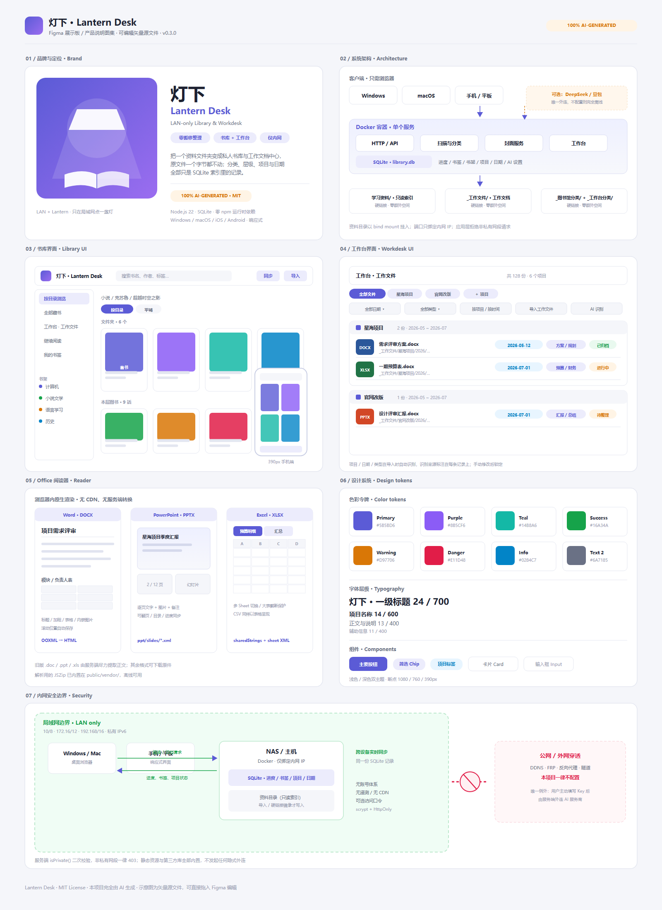

# 灯下 · Lantern Desk

[](LICENSE)
[](https://nodejs.org/)
[](docker-compose.yml)
[](CONTRIBUTING.md)
[](#-安全与隐私)
[](#-关于本项目)

> 把一个资料文件夹变成**私人书库 + 工作文档中心**——不搬动、不复制、不删除任何一个原文件。
> 书按目录层级整理、生成真实封面；工作用的 Word / PPT / Excel 自动归入项目、标记日期与类型。
> 全格式网页阅读、跨设备续读、书架、书签、AI 问答；**只在局域网内提供服务**。

一个 Docker 容器、一份 SQLite 索引、零 npm 运行时依赖（PDF.js / JSZip 已内置），可在 Windows / macOS / 手机浏览器、群晖 NAS、任意 Linux 主机上运行。已在 6000+ 文件 / 800 GB 量级的真实资料库上验证。

> [!IMPORTANT]
> **本项目完全由 AI 生成（100% AI-generated）。**
> 架构设计、前后端代码、SQLite 迁移、部署脚本、响应式样式、OOXML 解析、示意图、[Figma 展示板](docs/figma/README.md)以及这份 README，
> 全部由 AI 助手在一次对话中产出，没有人工逐行编写代码，也没有从其他项目复制代码。
> 项目按「原样」以 MIT 许可证开放；AI 生成的代码可能包含未被发现的问题，用于存放重要资料前请自行审计、备份并先在测试目录试跑。
>
> **English:** This entire project — code, docs, diagrams and Figma showcase — was produced by an AI assistant.
> It is provided "as is" under the MIT License. Please review and test it before trusting it with important data.

<details>
<summary><b>English summary</b></summary>

**Lantern Desk** turns an existing folder of study materials into a private, LAN-only library **and** a work-document desk. It indexes files in place (never moves or deletes them), builds a browsable folder hierarchy with automatic series detection, generates real covers, and serves a responsive reader for PDF / EPUB / TXT / MOBI and **Word / PowerPoint / Excel / CSV** (OOXML rendered natively in the browser). Work files are auto-filed into projects with business dates and document types, editable and lockable at any time. Reading progress, bookmarks, shelves, project metadata and AI settings live in one SQLite database so every device sees the same state. No public exposure, no tunnel, no account system. AI question-answering is optional and requires your own API key. Everything in this repository was generated by AI.

</details>

## 关于名字

**灯下 / Lantern Desk**：`LAN` + `Lantern`——只在局域网里点一盏灯，光不外泄；「灯下」既是灯下读书，也是灯下办公，`Desk` 对应新增的工作台。
建议 GitHub 仓库名 **`lantern-desk`**。为兼容已经在运行的部署，代码目录与容器名仍沿用 `lan-library`，改名不影响任何功能。

---

## 目录

- [特性](#-特性)
- [示意图](#-示意图)
- [Figma 设计展示](#-figma-设计展示)
- [快速开始](#-快速开始)
- [配置说明](#-配置说明)
- [项目结构](#-项目结构)
- [功能详解](#-功能详解)
- [API 速查](#-api-速查)
- [安全与隐私](#-安全与隐私)
- [开发与测试](#-开发与测试)
- [常见问题](#-常见问题)
- [贡献](#-贡献)
- [发布到自己的 GitHub](#-发布到自己的-github)
- [许可证与第三方组件](#-许可证与第三方组件)

---

## ✨ 特性

| 能力 | 说明 |
| --- | --- |
| **零搬移整理** | 原文件一个字节都不动；分类、标签、层级、书架、项目、日期全部是 SQLite 索引记录。文件减少只标记失效，不删磁盘文件 |
| **书库：目录层级浏览** | 按磁盘真实目录链逐层进入，带面包屑；空目录链自动展开；不同目录下的同名「第01回」绝不混在一起 |
| **书库：套书自动聚合** | `第0X回 / 第0X话 / 01卷 / 01` 等序号型目录合并为一张套书卡片，点进去按自然序排列章节 |
| **书库：真实封面** | 现成封面图 → 图片原图 → EPUB 内嵌封面 → PDF 首页（浏览器渲染后回传缓存）→ 排版式文字封面兜底；一次生成，全设备共用 |
| **工作台：工作文件整理** | 导入 Word / PPT / Excel / PDF / 图片等任意工作文件，自动识别**所属项目、业务日期、文档类型**并标记识别来源；按项目或时间分组，支持手动改、置顶、状态、备注与项目 CRUD |
| **工作台：AI 辅助归档** | 可选让已配置的 AI 账户批量推断项目与日期；不配置时纯离线规则照常工作，手动修改过的字段永不被覆盖 |
| **Office 在线预览** | Word（标题 / 加粗 / 表格 / 图片）、PowerPoint（逐页幻灯片 + 备注）、Excel（多 Sheet 表格）、CSV，全部在浏览器内用内置 JSZip 解析 OOXML，**无需安装 Office、无需联网** |
| **笔记原生渲染** | **Markdown**（标题 / 表格 / 代码块 / 任务列表 / 引用 / 图片）、**HTML / MHTML 网页存档**、reStructuredText / AsciiDoc / Org-mode / Textile / MediaWiki、JSON / YAML / XML / OPML 与常见源码，浏览器内安全排版，自动生成标题目录并按滚动位置续读 |
| **其他格式阅读** | PDF、EPUB、TXT、MOBI/AZW 网页内阅读；旧版 `.doc/.ppt/.xls` 尽力提取正文；图片/常见音视频可播放，其余格式可下载 |
| **跨端续读与书签** | 阅读进度（含 Word / 笔记滚动位置、PPT 页码、Excel 工作表）、书签按文档存服务端，PC / Mac / 手机共享 |
| **书架** | 默认按顶层文件夹生成；书架与图书均可增删改查，调整归属不影响文件存储位置 |
| **自动扫描同步** | 每 N 分钟增量扫描 + 网页手动「同步」；书库与工作台一次扫描完成，按 `path / size / mtime` 判断新增与减少 |
| **双通道导入** | 「图书 / 资料」按智能分类落到 `_导入图书/分类/主题/`；「工作文件」按 `_工作文件/项目/年/年月/` 归档。同名不覆盖 |
| **两套分类镜像** | 可选生成 `_图书馆分类/分类/原目录链/` 与 `_工作台分类/项目/年月/类型/`，用**硬链接**实现零额外空间的整理视图，SMB 也能看 |
| **AI 阅读助手** | 阅读时侧栏提问，可带选中文字作上下文，SSE 流式回答；支持 DeepSeek / 豆包 / 任意 OpenAI 兼容端点 |
| **仅内网** | 端口只绑定指定局域网 IP；应用层拒绝非私有 IP（403）；可选访问口令；无外网映射、无穿透、无遥测 |
| **全平台适配** | 响应式布局：桌面侧栏、平板收窄、手机底部导航；深浅主题；无前端框架、无 CDN 依赖 |

---

## 🧭 示意图

> 每张图都有两份：`docs/images/*.png` 用于 README 预览（兼容所有 Markdown 渲染器），`docs/images/*.svg` 是可编辑的矢量源。改图时编辑 SVG 后重新导出 PNG 即可。

### 1. 系统架构



客户端只需浏览器；容器内部由 HTTP 服务、扫描/分类引擎、SQLite、封面服务与工作台组成；资料目录以 bind mount 挂入，原件只读索引。右侧的 AI 服务是**唯一可选外连**，不配置时整套系统完全离线。

### 2. 目录层级与套书聚合



「第03回」被平铺摊开的问题，根因是旧版按分类平铺 6000+ 文件。现在按磁盘目录链建树：同一套漫画的 9 个分回收进一张「套书」卡片，另一套的 2 卷各自独立，互不混淆。

### 3. 数据流动


阅读进度、书签、书架、工作文件归档信息都是服务端数据库记录；扫描只对比元数据，几千个文件的增量扫描通常在 1 秒内完成。

### 4. 内网安全边界


### 5. 响应式界面


### 部署流程（Mermaid）


### 工作文件归档时序（Mermaid）



---

## 🎨 Figma 设计展示

项目提供一套**可直接拖入 Figma 的矢量展示板**：7 个画板（品牌 / 架构 / 书库 UI / 工作台 UI / Office 阅读器 / 设计系统 / 安全边界），文字与形状均为内联属性的可编辑图层。



| 链接 | 说明 |
| --- | --- |
| [浏览器展示页（逐张查看）](docs/figma/preview.html) | 本地 HTML 预览，7 个画板逐张展示 |
| [Figma 可导入总览 SVG](docs/figma/lantern-desk-showcase.svg) | 一次拖进 Figma 即得全部画板 |
| [7 张独立画板 SVG](docs/figma/frames/) | 按需单独导入某一张 |
| [工作台界面画板](docs/figma/04-workdesk-ui.png) · [Office 阅读器画板](docs/figma/05-reader.png) | 单张 PNG 预览 |
| [Figma 官网](https://www.figma.com/) | 新建设计文件后拖入上面的 SVG |
| [导入与发布说明](docs/figma/README.md) | 导入步骤、改图脚本、发布分享链接的方法 |

**Figma 分享链接（发布后填写）**

```text
FIGMA_SHARE_URL = <把 Figma 文件 / Community 的公开分享链接粘贴到这里，替换这一行>
```

> 仓库**不会伪造一个不存在的 `figma.com` 文件链接**：AI 无法代替你登录 Figma 账号创建云端文件。
> 请把上面的展示板导入 [Figma](https://www.figma.com/) → Share 设为「Anyone with the link can view」→ 复制公开链接替换 `FIGMA_SHARE_URL` 这一行即可（或把链接发给维护者 / AI 助手代填）。
> 未填写时，上面的预览与 SVG 源文件链接依然完全可用。展示板同样由 AI 生成，采用 MIT 许可。

---

## 🚀 快速开始

### 前置条件

- Docker + Docker Compose v2（或群晖 Container Manager / 其他支持 Compose 的容器平台）
- 一份已有的资料目录，例如 `学习资料/`，里面可以有任意层级、任意数量的文件
- 一台与客户端处于同一局域网的主机

> 不需要数据库服务、不需要 npm install、不需要 Microsoft Office、不需要外网（AI 功能除外）。

### 方式 A：Docker Compose（推荐，通用）

```bash
git clone https://github.com/CrystalGabrielle/LanternDesk.git
cd lantern-desk

cp .env.example .env         # 然后按下面「配置说明」修改
mkdir -p data library-data

# 把你的资料放到 PUBLIC_HOST/LIBRARY_SUBDIR 对应的位置。
# 以模板默认值为例，即 ./library-data/学习资料/，也可以直接用软链接指向已有目录：
#   ln -s /path/to/学习资料 ./library-data/学习资料

docker compose up -d --build
docker compose logs -f        # 首次启动会打印扫描结果
curl http://<HOST_IP>:8090/api/health     # 返回 {"ok":true,...} 即成功
```

同一局域网的设备打开 `http://<HOST_IP>:8090`。若填的是 `127.0.0.1`，只有主机本机可访问。

### 方式 B：群晖 Synology / Container Manager

1. 在 DSM 中安装 **Container Manager**，开启 SSH。
2. 把仓库放到共享目录，例如 `/volume1/docker/lantern-desk`（沿用 `lan-library` 也可以），并创建 `data/`。
3. 参考 `.env.example` 创建 `.env`，示例：

   ```ini
   HOST_IP=192.168.1.10
   PORT=8090
   PUBLIC_HOST=/volume1/your-share
   LIBRARY_SUBDIR=学习资料
   DATA_HOST=/volume1/docker/lantern-desk/data
   SCAN_INTERVAL_MIN=10
   ```

4. 在 Container Manager 中「项目 → 新增 → 从 docker-compose.yml 创建」，或在 SSH 中执行 `docker compose up -d --build`。

也可以用仓库自带的辅助脚本从本机一键上传并启动（脚本走 SSH 的 tar 通道，兼容未开放 SFTP 的群晖；凭据只从环境变量读取）：

```bash
pip install paramiko
NAS_HOST=192.168.1.10 NAS_USER=your_user NAS_PWD=your_password \
  python deploy/deploy.py
```

更多细节见 [docs/DEPLOYMENT.md](docs/DEPLOYMENT.md)。

### 方式 C：本地开发（不装 Docker）

需要 Node.js 22+（使用内置 `node:sqlite`）：

```bash
PORT=8090 \
DATA_DIR=./data \
BOOKS_ROOT=./library-data/学习资料 \
PUBLIC_ROOT=./library-data \
node --experimental-sqlite server/index.js
```

浏览器打开 `http://127.0.0.1:8090`。改前端代码后刷新即可；改后端需重启进程。

### 首次使用建议

1. 打开网页 → 点右上角「同步」，确认索引数量与磁盘文件数一致。
2. **书库**：切到「按目录浏览」看层级与套书；**工作台**：点「导入工作文件」拖入一份 Word / PPT / Excel，看自动识别出的项目与日期。
3. 在「设置」里可开启访问口令、填写 AI Key（不填也能正常使用）。
4. 想让 SMB / 文件管理器里也看到整理后的目录，在设置中生成分类镜像，或在工作台点「归档镜像」。

---

## ⚙️ 配置说明

所有本机相关的配置都写在 `.env`（**已被 `.gitignore` 忽略，不会被提交**），模板见 `.env.example`。

| 变量 | 默认值 | 说明 |
| --- | --- | --- |
| `HOST_IP` | `127.0.0.1` | 端口绑定的局域网 IP。**必须填本机内网 IP** 才能让手机/其他电脑访问；不要填 `0.0.0.0` |
| `PORT` | `8090` | 对外端口，完整地址 `http://HOST_IP:PORT` |
| `PUBLIC_HOST` | 必填（模板为 `./library-data`） | 资料目录的**父目录**，容器内挂到 `/lanpublic`。书库、工作目录与两套镜像都在这个挂载点内 |
| `LIBRARY_SUBDIR` | `学习资料` | 资料目录名；书库根目录 = `${PUBLIC_HOST}/${LIBRARY_SUBDIR}` |
| `DATA_HOST` | `./data` | SQLite 数据库、封面缓存、设置的持久化位置 |
| `SCAN_INTERVAL_MIN` | `10` | 自动扫描间隔（分钟），最小 1 |
| `WORK_DIR` | `_工作文件` | 工作文件根目录名（位于 `PUBLIC_ROOT` 下，**与书库隔离**） |
| `WORK_MIRROR_DIR` | `_工作台分类` | 工作文件归档镜像目录名 |
| `TZ` | `Asia/Shanghai` | 容器时区，影响日期识别与展示 |

应用内部环境变量（一般由 Compose 注入，无需手改）：

| 变量 | 容器内默认 | 说明 |
| --- | --- | --- |
| `PORT` | `8090` | HTTP 监听端口 |
| `DATA_DIR` | `/data` | 数据库与封面缓存目录 |
| `BOOKS_ROOT` | `/lanpublic/books` | 书库根目录（Compose 会设为 `/lanpublic/${LIBRARY_SUBDIR}`） |
| `PUBLIC_ROOT` | `/lanpublic` | 资料父目录 |
| `WORK_ROOT` | `${PUBLIC_ROOT}/${WORK_DIR}` | 工作文件根目录，独立于书库 |
| `SCAN_INTERVAL_MIN` | `10` | 自动扫描间隔 |
| `IMPORT_DIR` | `_导入图书` | 图书导入落盘目录名 |
| `MIRROR_DIR` | `_图书馆分类` | 图书分类镜像目录名 |

> ⚠️ **硬链接前提**：`PUBLIC_HOST` 必须是**单个挂载点**，书库目录、工作目录与两个镜像目录必须在同一文件系统内。若来自不同卷/挂载点，硬链接会报 `EXDEV`，此时索引与网页功能不受影响，只是镜像无法生成。

---

## 🗂 项目结构

```text
lantern-desk/                    # 部署目录沿用 lan-library 也可以
├── docker-compose.yml          # 仅绑定内网 IP；配置全部来自 .env
├── Dockerfile                  # node:22-bookworm-slim，零 npm install
├── .env.example                # 配置模板（复制为 .env 使用）
├── .env                        # 本地配置，被 .gitignore 忽略
├── server/
│   ├── index.js                # HTTP 服务、路由、内网校验、AI 代理、双通道导入、静态资源
│   ├── core.js                 # 书库：SQLite 表结构、智能分类、增量扫描、书架、分类镜像
│   ├── work.js                 # 工作台：项目 / 日期 / 类型识别、OOXML 属性读取、归档镜像、CRUD、AI 归档
│   ├── tree.js                 # 目录前缀树、套书判定、章节自然序、自动展开
│   └── covers.js               # 封面解析 / 缓存 / SVG 兜底
├── public/
│   ├── index.html              # 单页骨架
│   ├── style.css               # 全部样式与响应式断点（含工作台、Office 与笔记阅读器）
│   ├── app.js                  # 前端逻辑：书库、工作台、阅读器、书架、书签、AI、封面队列
│   ├── office.js               # Word / PPT / Excel 的 OOXML 解析与 HTML 渲染（自研，零新依赖）
│   ├── notes.js                # Markdown / HTML / MHTML / 轻量标记 / 源码的解析、消毒与排版（自研，零新依赖）
│   └── vendor/                 # 内置 PDF.js、JSZip、CMap 字体数据（离线可用）
├── deploy/
│   └── deploy.py               # 可选：SSH 上传到 NAS 并 compose up
├── docs/
│   ├── images/                 # README 使用的 SVG 示意图 + PNG 预览
│   ├── figma/                  # Figma 展示板：总览 SVG / 7 张画板 / PNG / 预览页 / 生成脚本
│   ├── API.md                  # 完整接口说明（含工作台接口）
│   └── DEPLOYMENT.md           # 部署、备份、升级与排障
├── .github/                    # CI、Issue / PR 模板
├── LICENSE                     # MIT
├── CONTRIBUTING.md
├── SECURITY.md
├── CHANGELOG.md
└── THIRD_PARTY_NOTICES.md
```

`data/`（运行时生成）包含 `library.db` 与 `covers/`；`library-data/`（示例资料目录）与二者都不入库。

---

## 📖 功能详解

### 1. 智能分类整理（原文件零搬移）

扫描时递归遍历书库目录（最多 12 层），跳过 `@eaDir`、`Thumbs.db`、临时文件等噪音，对每个文件计算：一级分类、二级主题、标签、类型、格式、目录路径、是否为封面素材。

- 一级分类优先取顶层文件夹映射（`计算机 / 语言 / 数学 / 历史 / 小说 / 道`），否则按文件名与路径关键词推断。
- 二级主题按 `SUB_TOPICS` 关键词细分（Python、Java、前端、算法、英语、经史典籍…）。
- 规则全部在 [`server/core.js`](server/core.js) 的 `TOP_CATEGORY / KEYWORD_CATEGORY / SUB_TOPICS` 里，可直接改成自己的分类体系。
- 分类结果只写数据库；**磁盘上的文件不会被移动、重命名、复制或删除**。

### 2. 按层级浏览与套书

- 默认「按目录」模式：面包屑 + 文件夹卡片 + 本层直属图书，路径写进 URL `?path=`，刷新/换设备可回到同一层。
- 右上角可切「平铺」；搜索、继续阅读、书签视图自动使用平铺。
- 目录内文件多数为序号命名时，自动判定为「套书」，章节按自然数排序（第 2 话排在第 10 话前面）。
- 仅有单一子目录且本层没有直属图书时自动展开，避免连点多层空白目录。

### 3. 支持的格式

| 类别 | 格式 | 网页内 |
| --- | --- | --- |
| 电子书 | PDF、EPUB、MOBI / AZW / AZW3、FB2、DJVU、CHM | PDF（PDF.js）、EPUB / MOBI（JSZip / 文本提取）可阅读；小众格式提供下载 |
| Word | **DOCX / DOCM**、DOC / WPS / RTF / ODT | **DOCX 富文本渲染**（标题、加粗、表格、内嵌图片）；旧版 DOC 尽力提取正文；ODT 提供下载 |
| PowerPoint | **PPTX / PPTM**、PPT / DPS / ODP | **PPTX 逐页幻灯片**（标题、要点、图片、备注），可翻页 / 目录 / 进度同步；旧版 PPT 尽力提取正文 |
| Excel | **XLSX / XLSM / XLTX / CSV**、XLS / ET / ODS | **XLSX 多 Sheet 表格**、CSV 表格视图；旧版 XLS 尽力提取正文 |
| 笔记 · Markdown | **MD / MARKDOWN / MDOWN / MKD / MDX** | **完整渲染**：多级标题、front matter 元数据卡、粗斜体 / 删除线 / 高亮、行内代码、链接、图片、表格、任务列表、引用、围栏代码块、分隔线；自动生成标题目录 |
| 笔记 · 网页存档 | **HTML / HTM / XHTML / MHT / MHTML** | **安全渲染**：DOMParser 白名单消毒后保留排版；MHTML 自动解码 quoted-printable / base64 内嵌图片与 `Content-Location` 映射；UTF-8 / GB18030 自动识别 |
| 笔记 · 轻量标记 | RST / REST、ADOC / ASCIIDOC / ASC、ORG、TEXTILE、WIKI / MEDIAWIKI | 尽力转换为标题、列表、代码块、强调与表格的近似排版（轻量实现，不追求完整规范） |
| 笔记 · 数据与源码 | JSON / JSONC / JSONL、YAML / TOML / INI / CFG、XML / OPML、TEX / SQL、常见编程语言与配置文件扩展 | JSON 自动格式化 + 语法高亮；OPML 渲染为可折叠大纲树；其余显示为等宽代码视图 |
| 纯文本 | TXT、MOBI / AZW 文本提取、CSV（表格视图） | 分页阅读，自动处理 UTF-8 / GB18030 中文编码 |
| 图片 | JPG / PNG / WEBP / GIF / BMP / TIFF | 可预览，带「封面 / cover」字样的图片被识别为封面素材 |
| 音视频 | MP3 / WAV / FLAC / M4A / OGG、MP4 / WEBM / MOV / M4V | 可播放 |
| 其他 | RMVB / RM / FLV / WMV / VOB / MKV、ZIP / RAR / 7Z / ISO | 浏览器无法原生播放，提供下载 |

> 新版 Office 用浏览器内置的 ZIP/XML 能力解析 OOXML，**不需要安装 Microsoft Office、不需要服务端转换、不需要联网**；旧版二进制格式（OLE）无法无损还原排版，只能尽力提取文字，建议另存为 `.docx/.pptx/.xlsx` 后重新导入。笔记类格式统一归为「笔记」类型，可在侧栏按类型筛选。

### 4. 在线预览实现（Office 与笔记）

**Office（[`public/office.js`](public/office.js)）**

- 用页面已内置的 JSZip 读取 OOXML：`word/document.xml` → 段落/标题/表格/图片；`ppt/slides/slideN.xml` → 逐页文字、图片与备注；`xl/sharedStrings.xml` + `xl/worksheets/*` → 多 Sheet 单元格。
- 输出 HTML 前统一转义，剥离脚本与外链资源；DOCX 内嵌图片经 `word/_rels/document.xml.rels` 映射后转 base64 内联，不发起任何外部请求。
- Word 按滚动位置、PPT 按页码、Excel 按工作表记录进度与书签；选中文字可直接作为 AI 提问上下文。
- 大表自动截断（前 300 行 / 60 列）并提示下载原文件；解析失败时自动退回服务端纯文本提取。

**笔记（[`public/notes.js`](public/notes.js)，自研、零依赖）**

- Markdown 解析器覆盖块级与行内语法，输出前把所有用户输入转义；轻量标记语言先转成 Markdown 再复用同一套渲染。
- HTML / MHTML 先经 `DOMParser` + 标签 / 属性白名单消毒：移除 `script / style / iframe / object / form / svg`、所有 `on*` 事件属性、`style` 属性、`javascript:` / `vbscript:` / `data:text/html` URL；Markdown 中内嵌的 HTML 同样走这一层。
- 相对图片只经 `GET /api/asset/:id?p=...`（或工作台版）读取：服务端校验路径必须在资料根目录内、拒绝绝对路径与协议、只允许图片/字体扩展名，并附加 `nosniff` 与 CSP sandbox。HTML 里的本地内链不跳转，点击时提示下载原文。
- MHTML 按 `boundary` 拆段、解码 quoted-printable / base64，把 `Content-Location` / `Content-ID` 资源转成 `data:` URL 内联，离线也能看到图片。
- 服务端 `/api/note/:id` 返回解码后的 UTF-8 原文（GB18030 自动回退，最大 6 MB）；`/api/text/:id` 对 HTML 返回去标签纯文本，供搜索与 AI 上下文使用。
- 标题自动生成目录并支持点击跳转；滚动百分比写入 `progress.locator = { "type": "note", "scroll": 64.6 }`，换设备打开时自动恢复位置。

### 5. 工作台：工作文件智能整理

工作文件与书库**完全隔离**：独立目录 `${PUBLIC_ROOT}/_工作文件/`、独立表 `work_files` / `work_projects`，不会把 6000+ 本藏书混进工作台，也不会让工作文档变成一本书。

导入一份 Word / PPT / Excel 时，系统综合以下线索自动归档：

| 维度 | 识别线索（按优先级） |
| --- | --- |
| **所属项目** | 文件名中的 `【项目】` / `[项目]` / `#项目` / `项目-xxx` → 已知项目库匹配 → 目录名 → 文件名首段；无法判断时标为「未归档」 |
| **业务日期** | 文件名中的 `2026-05-12` / `20260512` / `2026年5月12日` / `2026-07` / `2026Q3` / `2026年度` → OOXML 文档属性 `dcterms:created` → 文件修改时间 |
| **文档类型** | 会议纪要、方案 / 规划、需求 / PRD、设计 / 原型、汇报 / 总结、合同 / 法务、预算 / 财务、数据 / 报表、测试 / QA、调研 / 评审、计划 / 排期、通知 / 公文、简历 / 人事、讲义 / 培训等关键词 + 扩展名兜底 |
| **来源标注** | 每条记录都保存 `project_source` / `date_source`（文件名 / 文档属性 / 修改时间 / 手动指定 / AI 识别），界面上可见 |

- 落盘结构：`_工作文件/<项目>/<年>/<年-月>/<文件名>`；同名自动加时间戳，不覆盖。
- **手动修改即锁定**：改过的项目 / 日期 / 类型写入 `locked` 字段，后续扫描与「重跑规则」都不会覆盖。
- 项目支持新建、改名、改色、删除（文件改回「未归档」，绝不删文件）；文件支持编辑、置顶、状态、备注、移出工作台（原文件保留）。
- 书库里已有的文档可通过卡片菜单「加入工作台」，只是新增一条索引引用，原位置不变。
- 可选「AI 识别」：用你自己的 DeepSeek / 豆包账户批量推断项目与日期；**不配置 AI 时全部离线规则照常可用**。
- 可选「归档镜像」：`_工作台分类/<项目>/<年-月>/<类型>/` 硬链接视图，零额外空间，SMB 可见。

### 6. 封面

优先级：同目录现成封面图 → 图片本身 → EPUB 内嵌封面 → PDF 首页 → SVG 文字封面兜底。PDF 首页由浏览器用内置 PDF.js 渲染成 JPEG，通过 `POST /api/cover/:id` 回传并缓存在 `data/covers/`，**一次生成、所有设备共用**；超大扫描件（> 260 MB）自动跳过。

### 7. 阅读进度与书签

进度记录 `locator`（页码 / 章节 / 滚动位置 / 工作表）、百分比、设备名与更新时间；书签含标签、备注和定位。两者都存在服务端 SQLite，跨设备即时可见。工作文件用负数主键复用同一套进度 / 书签 / AI 历史，不与图书冲突。

### 8. 书架与图书增删改查

- 首次扫描按顶层文件夹自动创建默认书架；书架：新建、改名、改色 / 图标、删除、添加 / 移除图书。
- 图书：编辑标题 / 作者 / 分类 / 标签、移出图书馆（`hidden=1`，保留磁盘文件）、恢复。
- **只有从网页导入的书**支持二次确认 `?purge=1` 彻底删除；原始资料永远不会被删除。

### 9. 自动扫描与双通道导入

- 定时（默认 10 分钟）+ 手动「同步」；一次扫描同时更新书库与工作台，对比 `size / mtime` 判断更新，消失的标记 `missing` 而不删记录。
- 导入弹窗分「图书 / 资料」与「工作文件」两个页签：前者按分类进 `_导入图书/`，后者按项目 + 日期进 `_工作文件/`。

### 10. 两套分类镜像（可选）

`POST /api/organize/materialize` 生成书库镜像，`POST /api/work/organize` 生成工作台镜像。两者都用**硬链接**，零额外空间；重建时通过 inode 校验，只清理本系统生成的旧链接，绝不碰原件。

> 硬链接与原件指向同一 inode：**删除链接不影响原件，但直接编辑链接文件会改到原件**，建议只读浏览。

### 11. AI 阅读助手

在「设置」中填写服务商、Base URL、模型名与 API Key，支持 DeepSeek、豆包（火山方舟 OpenAI 兼容端点）及任何 OpenAI 兼容服务。阅读时可对全书提问，或选中一段文字作为上下文，回答以 SSE 流式返回并保存会话历史。

- API Key 只存本地 `library.db`，接口返回时脱敏（只回显后 4 位）。
- 未配置 Key 时侧栏会提示去设置，其余功能完全可用、**不发生任何外连**。
- 启用后需要 NAS / 主机能访问对应服务商的公网地址。

---

## 🔌 API 速查

完整说明见 [docs/API.md](docs/API.md)。所有接口均受内网校验与可选访问口令保护。

### 书库

| 方法 | 路径 | 用途 |
| --- | --- | --- |
| GET | `/api/health` | 健康检查（无需口令） |
| GET | `/api/state` | 总数、笔记数、书架数、封面数、工作台统计、上次扫描、AI 状态 |
| GET | `/api/tree` | 目录层级视图（`path` / `drill` / 分类 / 搜索等筛选） |
| GET | `/api/books` `/api/facets` | 平铺列表、筛选、分页、排序 / 聚合 |
| GET/POST | `/api/cover/:id` | 封面图 / 回传浏览器渲染的 PDF 首页封面 |
| GET | `/api/raw/:id` `/api/text/:id` `/api/download/:id` | 原文件（支持 Range）/ 纯文本 / 附件下载 |
| GET | `/api/note/:id` `/api/asset/:id?p=` | 笔记渲染原文（UTF-8 / GB18030）/ 笔记内相对图片等资源（带路径校验） |
| GET/POST/PATCH/DELETE | `/api/shelves...` | 书架与成员增删改查 |
| GET/PATCH/DELETE | `/api/books/:id` | 图书详情、编辑、移出 / 恢复 / 彻底删除 |
| GET/PUT | `/api/progress/:id` | 阅读进度读写 |
| GET/POST/PATCH/DELETE | `/api/bookmarks...` | 书签增删改查 |
| POST | `/api/scan` | 手动增量扫描（书库 + 工作台） |
| POST | `/api/import` | 图书导入（请求头 `x-file-name` 为 URL 编码文件名） |
| POST | `/api/organize/materialize` | 生成 / 重建书库分类镜像硬链接 |

### 工作台

| 方法 | 路径 | 用途 |
| --- | --- | --- |
| GET | `/api/work/files` | 工作文件列表（`project` / `month` / `type` / `status` / `q` / 分页） |
| GET | `/api/work/facets` | 项目 / 年月 / 类型 / 格式 / 状态聚合与待归档统计 |
| GET/PATCH/DELETE | `/api/work/files/:id` | 详情 / 编辑归档信息 / 移出工作台（原文件保留） |
| POST | `/api/work/files/:id/restore` | 恢复 |
| GET/POST/PATCH/DELETE | `/api/work/projects...` | 项目增删改查 |
| POST | `/api/work/import` | 导入工作文件并自动识别项目 / 日期 / 类型 |
| POST | `/api/work/adopt` | 把书库里的文档加入工作台 |
| POST | `/api/work/reclassify` | 按离线规则重新识别（尊重手动锁定） |
| POST | `/api/work/ai-classify` | 可选：用已配置的 AI 批量推断项目与日期 |
| POST | `/api/work/organize` | 生成 / 重建工作台归档镜像硬链接 |
| GET | `/api/work/raw/:id` `/api/work/text/:id` `/api/work/download/:id` | 工作文件原文件 / 文本 / 下载 |
| GET | `/api/work/note/:id` `/api/work/asset/:id?p=` | 工作笔记渲染原文 / 笔记内相对资源 |

### AI 与设置

| 方法 | 路径 | 用途 |
| --- | --- | --- |
| GET/PUT | `/api/settings/ai` | AI 配置（Key 脱敏） |
| POST | `/api/ai/test` `/api/ai/chat` | 连通性测试 / 流式问答 |
| GET/DELETE | `/api/ai/history` | 会话历史 |
| POST | `/api/login`、PUT `/api/settings/pin` | 访问口令 |

---

## 🔒 安全与隐私

- **没有公网入口**：`docker-compose.yml` 只把端口绑定到 `HOST_IP`，不监听 `0.0.0.0`；仓库不含 DDNS、FRP、反向代理或任何隧道配置。
- **应用层二次校验**：服务端 `isPrivate()` 检查来源 IP，非私有网段一律返回 `403`。
- **可选访问口令**：scrypt 加盐哈希 + HttpOnly Cookie；未设置时免登录（适合家庭内网）。
- **数据不外传**：没有账号体系、没有遥测、没有 CDN；静态资源与第三方库全部内置。Office 与笔记文档都在**浏览器本地**解析，不上传给任何转换服务。唯一可能的外连是用户主动填写 Key 后的 AI 请求。
- **笔记内容消毒**：HTML / Markdown 内嵌 HTML 一律经过标签与属性白名单，脚本、事件属性与危险协议被移除；相对图片只能经带路径穿越校验的 `/api/asset` 接口读取，不加载外部资源。
- **原文件保护**：资料目录只做索引；「删除图书 / 移出工作台」默认仅移出索引；静态资源与文件接口都做了路径穿越校验。
- **备份**：只需备份 `DATA_HOST`（`library.db` + `covers/`）；资料目录本身不受本项目影响。

> ⚠️ 本项目**不是面向公网的 Web 应用**：没有限流、WAF、CSRF 防护和账号体系。请不要把它做外网穿透或暴露到公网，也不要在不可信网络中关闭访问口令。详见 [SECURITY.md](SECURITY.md)。
> 另外，本项目**完全由 AI 生成**，请在用于重要资料前自行审计代码与备份策略。

---

## 🧪 开发与测试

```bash
# 语法检查（无需安装依赖）
for f in server/*.js public/*.js; do node --check "$f"; done

# 本地起一个最小实例
mkdir -p /tmp/ll-test/books/小说 /tmp/ll-test/data /tmp/ll-test/public
echo "第一章" > "/tmp/ll-test/books/小说/样例.txt"
PORT=18090 DATA_DIR=/tmp/ll-test/data \
BOOKS_ROOT=/tmp/ll-test/books PUBLIC_ROOT=/tmp/ll-test/public \
node --experimental-sqlite server/index.js

curl http://127.0.0.1:18090/api/state
curl http://127.0.0.1:18090/api/tree
curl http://127.0.0.1:18090/api/work/facets

# 导入一份工作文件（x-file-name 需 URL 编码）
curl -X POST --data-binary @report.docx \
  -H 'x-file-name: report.docx' \
  http://127.0.0.1:18090/api/work/import
```

CI（`.github/workflows/ci.yml`）会在推送 / PR 时执行 JS 语法检查、敏感信息扫描、SVG/XML 校验（含 Figma 画板）、文档链接检查和 Docker 镜像构建。前端为原生 JS，无构建步骤，改完刷新浏览器即可。

---

## ❓ 常见问题

**Q：手机 / 别的电脑打不开？**
确认 `.env` 里 `HOST_IP` 填的是主机的局域网 IP（不是 `127.0.0.1`），客户端与主机在同一网段，且主机防火墙放行 `PORT`。

**Q：工作文件会混进书库吗？**
不会。工作文件放在 `${PUBLIC_ROOT}/_工作文件/`，与书库根目录平级，各有独立的 SQLite 表与界面。想让书库里已有的文档也出现在工作台，用卡片菜单「加入工作台」即可，原件位置不变。

**Q：看 Word / PPT / Excel 需要装 Office 吗？**
不需要。DOCX / PPTX / XLSX 是 ZIP + XML，浏览器用内置的 JSZip 解析后渲染，完全离线。旧版 `.doc/.ppt/.xls` 只能尽力提取文字，建议另存为新格式再导入。

**Q：Markdown / HTML 笔记里的图片、脚本和链接怎么处理？**
Markdown 按语法渲染成排版页面（表格、代码块、任务列表、目录等）；HTML / MHTML 先经过白名单消毒，脚本、事件属性、`iframe` 与 `javascript:` 链接一律移除，不会在页面里执行。笔记里写 `` 这类相对图片时，服务端会从笔记所在目录经 `/api/asset/:id?p=...` 读取（必须仍在资料根目录内，且只允许图片/字体）；MHTML 的内嵌图片会自动解码成 data URL。指向本地其他笔记的相对链接不会跳转，点击会提示下载原文；外部 `https://` 链接正常新窗口打开。

**Q：项目 / 日期识别不准怎么办？**
在文件行右侧菜单点「编辑归档信息」手动修改，改过的字段会自动锁定，后续扫描不会再覆盖。也可以点「AI 识别」让已配置的 AI 批量推断，或新建项目名让后续导入自动命中。

**Q：为什么有些封面一开始是文字占位？**
PDF 首页封面由浏览器首次打开时渲染并回传缓存，稍等片刻或刷新即可；超过 260 MB 的扫描件会跳过自动渲染。

**Q：分类镜像生成失败 / 报 EXDEV？**
书库目录、工作目录与镜像目录必须位于同一挂载点。把 `PUBLIC_HOST` 设为资料目录的父目录（单一 bind mount）。

**Q：删除一本书 / 移出工作台会删掉磁盘文件吗？**
默认不会，只标记 `hidden` 移出索引；仅网页导入的书支持 `?purge=1` + 二次确认后彻底删除。镜像里的链接删掉也不影响原件。

**Q：分类 / 项目规则不合我意怎么改？**
书库规则在 `server/core.js` 的 `TOP_CATEGORY / KEYWORD_CATEGORY / SUB_TOPICS`；工作台规则在 `server/work.js` 的 `STOP / DOC_TYPES / inferProject / inferDate`。改完重启容器点「同步」或「重跑规则」。

**Q：AI 一定要联网吗？**
不配置 AI Key 时全站完全离线。配置后，问答与「AI 识别」由服务端转发到你填的 Base URL，需要 NAS 能访问公网；网站本身依旧只监听内网。

**Q：Figma 链接在哪？为什么 README 里是占位符？**
展示板 SVG 与预览链接都是真实可用的；`FIGMA_SHARE_URL` 是等你把 SVG 导入自己的 Figma 账号、发布并复制公开链接后填写的位置。AI 无法代替你登录 Figma 创建云端文件，所以仓库不会写一个假的 `figma.com` 链接。步骤见 [docs/figma/README.md](docs/figma/README.md)。

**Q：这个项目真是 AI 写的吗？**
是。从代码到文档、示意图再到 Figma 展示板，全部由 AI 助手生成，详见顶部声明与 [CHANGELOG](CHANGELOG.md)。请以审计第三方代码的标准对待它。

**Q：如何备份 / 升级？**
备份 `DATA_HOST` 整个目录即可。`git pull` 后 `docker compose up -d --build`，数据库会自动做字段迁移，进度、书签、书架、项目与设置都会保留。

---

## 🤝 贡献

欢迎 Issue、功能建议与 Pull Request。请先阅读 [CONTRIBUTING.md](CONTRIBUTING.md)（开发约定、提交格式、测试要求），漏洞报告请按 [SECURITY.md](SECURITY.md) 的方式私下反馈。

适合入门的方向：更多电子书格式（CBZ / AZW3 排版）、OPDS 支持、多用户与只读角色、分类规则配置化、OOXML 更复杂排版（合并单元格、图表、SmartArt）、国际化文案。

> 由于本项目完全由 AI 生成，PR 里请注明代码是否由 AI 辅助生成，便于审阅与追溯。

---

## 📦 仓库镜像

本项目同步发布在以下平台（同一份代码，GitHub 为主仓库）：

| 平台 | 地址 |
| --- | --- |
| **GitHub（主）** | https://github.com/CrystalGabrielle/LanternDesk |
| Gitee | https://gitee.com/CrystalGabrielle/lantern-desk |

要复刻到自己的仓库，克隆后改掉文档里的仓库链接、按需保留或删除 `.github/`，然后：

```bash
git status --short            # 确认没有 .env / data / *.db / 截图
git remote add origin https://github.com/YOUR_GITHUB_NAME/lantern-desk.git
git push -u origin main
```

发布前建议再做三件事：

1. 把 [Figma 展示板](#-figma-设计展示)导入自己的 Figma，把公开分享链接替换 `FIGMA_SHARE_URL` 一行。
2. 在仓库设置里开启 **Private vulnerability reporting**（与 [SECURITY.md](SECURITY.md) 对应）。
3. 按 [CHANGELOG](CHANGELOG.md) 打一个 `v0.4.0` tag。CI 会自动跑语法检查、私有配置检查、SVG 校验和镜像构建。

---

## 📜 许可证与第三方组件

本项目采用 **MIT License**，详见 [LICENSE](LICENSE)。你可以自由使用、修改、商用与再分发，只需保留版权声明与许可证文本。

内置的第三方库及其许可证见 [THIRD_PARTY_NOTICES.md](THIRD_PARTY_NOTICES.md)：PDF.js（Apache-2.0）、JSZip（MIT / GPLv3 双许可）、Node.js（MIT）与 `node:sqlite`。
Office 预览引擎是本项目自研的 OOXML 解析代码，复用已内置的 JSZip，**没有引入新的运行时依赖**。

---

<p align="center">为那些不愿把资料交给云端的书架与书桌而做。 📚🛠️<br><small>100% AI-generated · MIT · LAN only</small></p>
